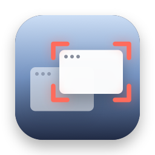
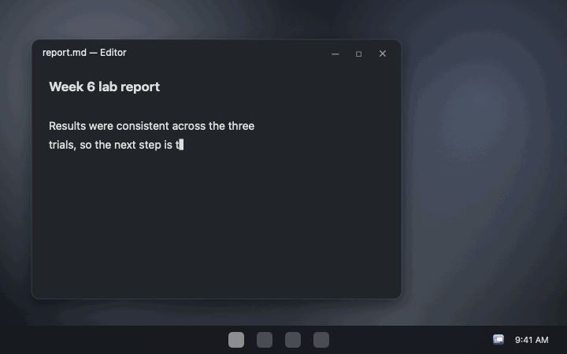

<p align="center">
  
</p>

<h1 align="center">Who Stole My Focus for Windows</h1>

<p align="center">
  <b>Find out which app keeps jumping in front of your work.</b><br>
  <i>Preview release.</i>
  A free, open-source tray app that logs every app that comes to the front on its own, and the keystrokes it stole, with no click or keypress from you before it. The Windows version of <a href="https://github.com/stanczykwyatt/who-stole-my-focus">Who Stole My Focus</a>, with the same rules.
</p>

<p align="center">
  <a href="https://github.com/stanczykwyatt/who-stole-my-focus-windows/releases/latest/download/WhoStoleMyFocus-win-x64.zip"><b>Download for Windows</b></a>
  &nbsp;·&nbsp;
  <a href="https://stanczykwyatt.github.io/who-stole-my-focus-windows/">Website</a>
  &nbsp;·&nbsp;
  <a href="https://github.com/users/stanczykwyatt/projects/1">Roadmap</a>
  &nbsp;·&nbsp;
  <a href="https://github.com/stanczykwyatt/who-stole-my-focus-windows/discussions">Discussions</a>
</p>

<p align="center">
  <a href="https://github.com/stanczykwyatt/who-stole-my-focus-windows/actions/workflows/ci.yml"></a>
  <a href="https://github.com/stanczykwyatt/who-stole-my-focus-windows/releases/latest"></a>
  
  
  
  <a href="LICENSE"></a>
</p>

<p align="center">
  
</p>

---

You're typing, and suddenly your words are going into some other window. Or a game minimizes itself mid-match. Something took focus, and by the time you look, it's gone.

Who Stole My Focus sits in the system tray and keeps a log of every app that comes to the front. Each one is checked against what you were doing just before: a click, Alt+Tab, Start or a launcher, or an app you just opened means you switched. Anything else stole focus, and the log names it, says what it took focus from, and how long it stayed.

It needs no admin rights, has no internet access, and nothing ever leaves your PC.

If it finds your culprit, [starring the repo](https://github.com/stanczykwyatt/who-stole-my-focus-windows/stargazers) helps other people find it.

## Features

- **Names the culprit.** Every steal shows the app, what it took focus from, when, and how long it stayed in front. Helpers with cryptic names show the product they belong to, like *SyncHelper (CloudSync)*.
- **Catches steals while you type.** An app that jumps in between your keystrokes is flagged even though you were pressing keys a moment before. That's the case that sends your typing into the wrong window.
- **Knows the shell.** The Alt+Tab switcher, Task View, the taskbar and the desktop pass through the front without being logged, and a touchpad swipe to another virtual desktop counts as yours.
- **Doesn't blame you for your own switches.** Clicks, Alt+Tab, Win+number and other shortcuts, Start, Search and launchers like PowerToys Run, and apps you just opened are all recognized as yours.
- **Doesn't blame the app you were using.** When focus goes back to it after a password prompt, the lock screen, or another app quitting or being minimized, that's logged as coming back, not as a steal.
- **Explains parts of Windows.** *CredentialUIBroker* is Windows asking for your password or PIN, *consent* is a User Account Control prompt. The log says so in plain words.
- **Top offenders.** See which apps steal focus most often, and which app they usually take it from.
- **The full story when you want it.** Switch the log to *Everything* to see every app that came to the front and why.
- **Optional notifications** the moment something steals focus, and **Copy as CSV** for a spreadsheet or a bug report to the app's developer.
- **Private by design.** No admin rights, no internet access, nothing ever leaves your PC. Free, with no account, subscription, tracking or dependencies.

## How it decides

Windows tells any app when a window comes to the front, and lets it notice when you click or press a key. Who Stole My Focus notes only *when*, and for keys only whether it was a modifier like Alt. Never which key or where. From those two things, each switch gets one of these:

| What happened | When |
|---|---|
| **You switched** | A click, a keyboard shortcut like Alt+Tab, or a key pressed in Start, Search or a launcher, just before. Parts of Windows you open yourself, like Start, Search and the notification center, always count as you |
| **You opened it** | Its first trip to the front after you opened it, even if it took a while to start, or the app coming back after it quit to update itself |
| **Came back** | Focus returned to the app you were using after a system prompt, the lock screen, or the app in front quitting or being minimized |
| **Stole focus** | None of the above: no click or keypress in the 1.5 seconds before, or you were typing before *and* after it came forward |
| **Not sure** | A plain keypress just before, and then you stopped typing: maybe you pressed Enter on something that opens it, maybe not. Also anything before your first click or keypress after it starts, like at sign-in. Not counted as a steal |

The rules are the same as the Mac app's, ported line by line and checked by the same scenario tests:

- **Typing through a switch counts as a steal.** If you pressed a key just before an app came forward and kept typing straight after, those keys were meant for the app you were in. It checks 0.4 seconds after the switch, quicker than you'd react to a new window, and a shortcut like Ctrl+T aimed at the new app doesn't count.
- **Every steal gets a second look.** Windows sometimes brings the next app forward before the last one has finished quitting, so a steal is only announced once that's ruled out.
- **The threshold is yours.** Change how soon after a click or keypress a switch still counts as yours, from 0.5 to 3 seconds.
- **It errs toward not blaming apps.** When it can't tell, it says so instead of calling it a steal. The lock screen and sign-in screen are ignored by default, and you can ignore any other app from the log.

## Install

> **Preview:** this hasn't been run on a real Windows PC yet. Its rules are a port of the Mac app's, and their 208 tests pass on Windows, Linux and macOS in CI, but the Windows parts (the tray, focus events and input times) have only been compiled. If you try it, please say how it went in [Discussions](https://github.com/stanczykwyatt/who-stole-my-focus-windows/discussions) or [open an issue](https://github.com/stanczykwyatt/who-stole-my-focus-windows/issues).

1. [Download **WhoStoleMyFocus-win-x64.zip**](https://github.com/stanczykwyatt/who-stole-my-focus-windows/releases/latest/download/WhoStoleMyFocus-win-x64.zip) (or [the Arm64 version](https://github.com/stanczykwyatt/who-stole-my-focus-windows/releases/latest/download/WhoStoleMyFocus-win-arm64.zip) for Snapdragon PCs) and unzip it.
2. Move **WhoStoleMyFocus.exe** somewhere it can stay, like a folder in your user folder, and open it. It's one file with everything it needs, so there's nothing to install.
3. Find it in the system tray, next to the clock. Click it to see the latest steals; **Show Log…** has everything.

To start it with Windows, turn on **Start with Windows** in its menu.

> **About the SmartScreen warning:** Windows may say it protected your PC from an unrecognized app. It shows up because the app isn't signed with a paid code-signing certificate, which costs hundreds of dollars a year. The code is fully open source, so you can read every line or build it yourself. Click **More info**, then **Run anyway**.

### Build from source

You need the [.NET 8 SDK](https://dotnet.microsoft.com/download/dotnet/8.0).

```bash
git clone https://github.com/stanczykwyatt/who-stole-my-focus-windows.git
cd who-stole-my-focus-windows
dotnet test
dotnet publish WhoStoleMyFocus -c Release -r win-x64 --self-contained -p:PublishSingleFile=true -o publish
```

## Privacy and security

- **Times, never keys.** It listens to Windows' raw input only to note when you last clicked, pressed a key or a modifier, or touched the screen or touchpad. From each key it reads only whether it was a modifier and whether it went up; it never knows which key, never sees text, and can't block or change input. CI checks exactly which fields are read.
- **Names, never windows.** For each app that comes to the front it reads the process's file name, description and start time. Never a window's title or contents.
- **Nothing leaves your PC.** It has no networking code and starts no other programs; CI fails the build if any appears. The log stays in `%LOCALAPPDATA%\WhoStoleMyFocus`.
- **Runs as you.** No admin rights, no service, no driver. It never sends input, never brings a window forward and never touches another app's memory.

The full details are in [SECURITY.md](SECURITY.md).

## FAQ

**How do I find out what's stealing focus on Windows?**
Run Who Stole My Focus and wait for it to happen again. Click its tray icon: the latest steal is at the top, with the app's name, what it took focus from and when.

**My game keeps minimizing. Will this find out why?**
Usually. When something takes focus from a full-screen game, it's logged with the game as what it took focus from. Parts of the system that run as another user show by their process name only.

**Is it a FocusLogger alternative?**
Yes. Both log which process takes focus; this one also judges each switch against what you did just before, so your own switches aren't listed as thefts, and it explains parts of Windows by name.

**Does it slow anything down?**
No. Windows tells it when the foreground changes, and it notes input times as they arrive. Once a second it checks whether the last few apps in front have quit, which costs next to nothing.

**What about apps running as administrator?**
While one is in front, Windows doesn't let an ordinary app notice clicks and keys in it, so switching away from it can look like a steal. Ignore the entry if it's yours.

## More free tools

- **[Who Stole My Focus](https://github.com/stanczykwyatt/who-stole-my-focus):** the original, for Mac.
- **[Show Desktop](https://github.com/stanczykwyatt/show-desktop):** hide every window with one click or ⌃⇧D, then bring them all back exactly as they were.
- **[Copy 2FA](https://github.com/stanczykwyatt/copy-2fa):** copy 2FA codes from Mail, Messages or a built-in authenticator with one keyboard shortcut.
- **[AI Footprint](https://github.com/stanczykwyatt/ai-footprint):** see what AI coding tools leave on your Mac, and what each update changed.
- **[Memo Export](https://github.com/stanczykwyatt/memo-export):** export your Voice Memos transcripts as Markdown, with the audio.
- **[Podcast Export](https://github.com/stanczykwyatt/podcast-export):** export your Apple Podcasts shows as OPML, and your listening history.
- **[Reading List Export](https://github.com/stanczykwyatt/reading-list-export):** export your Safari Reading List as Markdown, bookmarks and CSV.
- **[Unblock Eject](https://github.com/stanczykwyatt/unblock-eject):** see what's keeping your disk from ejecting, and quit it politely.
- **[Next Departures](https://github.com/stanczykwyatt/next-departures):** your stop's next bus and train, live, in the menu bar.
- **[Right Folder](https://github.com/stanczykwyatt/right-folder):** Open and Save dialogs, in the right folder.
- **[mulligan](https://github.com/stanczykwyatt/mulligan):** undo for coding agents. A command line tool for macOS and Linux.
- **[Tonecap](https://github.com/stanczykwyatt/tonecap):** design your keyboard's sound, with no recordings, and hear it as you type.

All but Next Departures have no internet access, and it connects only to the transit feeds you use.

## Contributing

Contributions are welcome, especially reports of switches it judges wrong. See [CONTRIBUTING.md](CONTRIBUTING.md), and the [roadmap](https://github.com/users/stanczykwyatt/projects/1) for what's planned. Ideas go in [Discussions](https://github.com/stanczykwyatt/who-stole-my-focus-windows/discussions).

## License

Who Stole My Focus is released under the [MIT License](LICENSE) and is provided as is, without warranty of any kind. The download includes Microsoft's .NET runtime, under the MIT License; see [licenses](licenses/README.md).

Who Stole My Focus is an independent project, not affiliated with Microsoft. Windows is a trademark of Microsoft Corporation. FocusLogger is named only to say what this is an alternative to. Other product names belong to their owners. The apps in the demo are made up.
